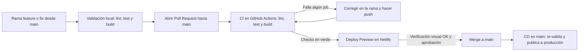
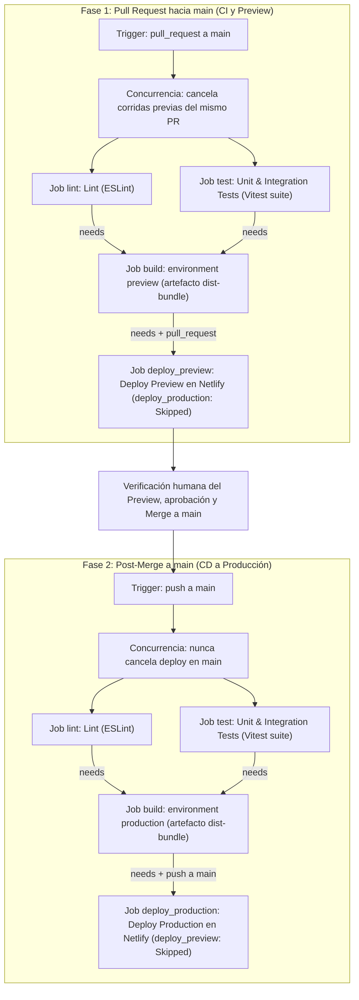

# Guía de Contribución a Ressume 🚀

¡Gracias por tu interés en contribuir a **Ressume**! Este proyecto es un editor de currículums de alta fidelidad basado en React, diseñado para garantizar **WYSIWYG 100% (What You See Is What You Get)** entre lo que el usuario edita en pantalla y el PDF vectorial final.

---

## 1. Las Reglas de Oro Inmutables (Invariantes de Arquitectura)

Antes de escribir cualquier línea de código, debes conocer las 3 leyes fundamentales del proyecto (documentadas en `AGENTS.md` y `FRACASO_SALTOS_DE_PAGINA.md`):

1. **La Caja A4 es Sagrada e Inmutable (`210mm x 297mm`, `overflow: hidden`)**:
   - El editor (`#area-cv`) **no es un lienzo continuo infinito**. Se compone estrictamente de cajas discretas `<A4PageBox pageNumber={N}>`.
   - Si un bloque no cabe en la Página 1, el distribuidor de páginas (`pageDistributor`) lo asigna a la Página 2.
2. **Estructura Fija Tallada en Piedra (Zero Dynamic Reflow on Print)**:
   - El editor es la **única fuente de verdad**. El motor de exportación a PDF (`src/services/print/`) es pasivo y determinista: proyecta exactamente las mismas cajas que el editor. No calcula saltos ni altera posiciones al imprimir.
3. **Prohibición de `break-before: page` en selectores repetidos**:
   - **NUNCA** apliques `break-before: page` a viñetas, ítems de experiencia o bloques `.cv-block`. Hacerlo provoca que un CV de 2 páginas se fracture en un PDF de 5 páginas.

---

## 2. Mapa Rápido de la Base de Código (SOLID & SSOT)

```
src/
├── constants/               # [SSOT] Dimensiones físicas A4, espaciados, paletas, fuentes
│   ├── geometry.js          # 210mm x 297mm, 794px x 1123px, A4_GEOMETRY
│   ├── spacing.js           # Defaults: pagePadding (24px), sectionGap (12px), itemGap (6px)
│   ├── colors.js            # Tokens semánticos y reglas Obsidian Callout
│   └── typography.js        # Fuentes soportadas y límites de escalado
│
├── styles/                  # [CSS Modular]
│   ├── tokens.css           # Variables :root canónicas
│   ├── print.css            # Reglas de fragmentación para impresión
│   └── bundle.js            # Bundle pre-concatenado para iframe y exportación
│
├── services/print/          # [SRP: Motor de Exportación]
│   ├── pdfTitleService.js   # Generación y sanitización determinista del título de archivo
│   ├── cleanHtmlGenerator.js# Serialización estática de cajas A4 sin controles interactivos
│   └── printExecutionDriver.js # Ciclo de vida del iframe de impresión y window.print()
│
├── registry/                # [OCP: Extensibilidad de Secciones]
│   ├── sectionRegistry.js   # Registro desacoplado de tipos de sección
│   └── itemFormatters.js    # Serializadores a Markdown, XML y Texto Plano
│
├── components/
│   ├── CV/                  # Componentes visuales del CV (A4PageBox, BaseSection, BaseItem)
│   └── Editor/              # Barra de herramientas (ActionMenu), modales y paneles
│       └── ActionMenu/      # Compound Components (DesignPanel, ActionMenuRoot)
│
└── tests/                   # 82 suites nucleares y +1,170 pruebas unitarias e integradas (Vitest)
```

---

## 3. Cómo Agregar una Nueva Sección en 3 Pasos (Principio Open/Closed)

El sistema está diseñado para que agregues nuevos tipos de sección (por ejemplo, *Certificaciones*, *Idiomas*, *Proyectos*) **sin modificar archivos nucleares**.

### Paso 1: Crea el componente de visualización del ítem
Crea el archivo en `src/components/CV/items/CertificatesItem.jsx`:

```jsx
import React from 'react';
import InlineEdit from '../../Editor/InlineEdit';

const CertificatesItem = ({ item = {}, sectionId, isPrint = false }) => {
  return (
    <div className="certificate__data cv-block" data-item-id={item.id}>
      <h3 className="certificate__title">
        <InlineEdit
          value={item.title || ''}
          placeholder="Nombre del Certificado"
          sectionId={sectionId}
          itemId={item.id}
          field="title"
          isPrint={isPrint}
        />
      </h3>
      <span className="certificate__issuer">
        <InlineEdit
          value={item.issuer || ''}
          placeholder="Entidad Emisora (ej. AWS)"
          sectionId={sectionId}
          itemId={item.id}
          field="issuer"
          isPrint={isPrint}
        />
      </span>
    </div>
  );
};

export default CertificatesItem;
```

### Paso 2: Registra la sección en `src/registry/sectionRegistry.js`
Agrega el descriptor en el registro llamando a `registerSectionType`:

```javascript
import CertificatesItem from '../components/CV/items/CertificatesItem';

registerSectionType({
  type: 'certificates',
  label: 'Certificados y Licencias',
  defaultTitle: 'CERTIFICADOS',
  defaultColumn: 'right',
  icon: 'Award',
  sectionClass: 'certificates',
  itemComponent: CertificatesItem,
  createDefaultItem: () => ({
    id: generateUniqueId('cert'),
    title: 'AWS Certified Solutions Architect',
    issuer: 'Amazon Web Services',
    date: '2024',
  }),
  // Cálculo de altura encapsulado para el paginador:
  estimateItemHeight: (item, options) => {
    return 36 + (options.itemGapPx ?? 8);
  },
  schema: {
    title: 'string',
    issuer: 'string',
    date: 'string',
  },
});
```

### Paso 3: Verifica tus pruebas
Ejecuta la suite de pruebas automatizadas:
```bash
npm test
```
¡Tu sección ya está completamente integrada! Se mostrará en el menú modal de agregar secciones, soportará arrastre con `@dnd-kit`, calculará su paginación y se imprimirá en el PDF sin tocar `App.jsx` ni el motor de impresión.

---

## 4. Guía de Ejecución de Pruebas y Validación de Calidad

### Validación Local (Docker recomendado o Node.js v22+)
```bash
# Con Docker (con el contenedor app corriendo)
docker compose exec app npm run lint
docker compose exec app npm test
docker compose exec app npm run build

# Con Node.js local
npm run lint
npm test
npm run test:watch
npm run build

# Ejecutar una suite específica de Vitest
npx vitest run src/tests/registry.test.jsx
```

### Criterio de Aceptación para Pull Requests (PR)
1. **Lint limpio**: `npm run lint` debe finalizar con `0 errors`.
2. **100% de tests unitarios e integración en verde**: los 92 archivos (1,259 tests en Vitest) deben pasar sin excepciones.
3. **Build de producción exitoso**: `npm run build` debe compilar `dist/` sin errores.
4. **Cero Números Mágicos**: si usas dimensiones físicas A4, impórtalas de `src/constants/`.
5. **Verificación Visual Empírica (Regla 6 de `AGENTS.md`)**:
   - JSDOM no evalúa fuentes subpíxel ni el motor `@media print`.
   - Si modificas layout, paginación o estilos de impresión, abre la aplicación en tu navegador (`http://localhost:5173`), presiona **Descargar / Imprimir PDF**, y confirma visualmente que el documento tiene **exactamente el número de páginas esperado** sin viñetas fracturadas ni saltos inesperados.

---

## 5. Flujo de Colaboración, Pull Requests y CI/CD

No se realizan cambios directamente sobre `main`. Toda modificación entra mediante Pull Request (PR) validada por el pipeline de GitHub Actions en `.github/workflows/ci-cd.yml`.

### Paso a paso para colaboradores

1. **Crear una rama desde `main` actualizada** usando prefijos claros (`feat/...`, `fix/...`, `docs/...`) y commits convencionales.
2. **Validar en local antes de subir cambios**: ejecutar `npm run lint`, `npm test` y `npm run build` (dentro de Docker o con Node local). Si agregaste o cambiaste dependencias, reconstruir el entorno con `docker compose up -d --build -V`.
3. **Abrir un Pull Request hacia `main`**: al crearse o actualizarse el PR, GitHub Actions dispara automáticamente el flujo de integración continua.
   - Si subes un commit nuevo al mismo PR mientras hay una corrida activa, la regla de concurrencia cancela la ejecución anterior para evitar colas innecesarias.
4. **Revisar checks y Deploy Preview**: esperar a que `Lint (ESLint)`, `Unit & Integration Tests (Vitest suite)` y `Build Production Bundle` pasen en verde, y verificar el enlace de preview desplegado en Netlify (`Deploy Preview (PR)`).
5. **Merge a `main` y despliegue a producción**: una vez aprobado y con todos los checks en verde, el merge hacia `main` ejecuta nuevamente el pipeline sin cancelarse por concurrencia y publica el artefacto verificado en producción (`Deploy Production (main)`).

### Flujo de Pull Request



### Workflow de CI-CD `.github/workflows/ci-cd.yml`

Un mismo workflow orquesta ambas fases de forma secuencial en el tiempo: primero valida y publica el **Preview del PR**, y recién tras verificarlo y hacer **merge a `main`**, el evento `push` dispara el despliegue a **Producción**.


